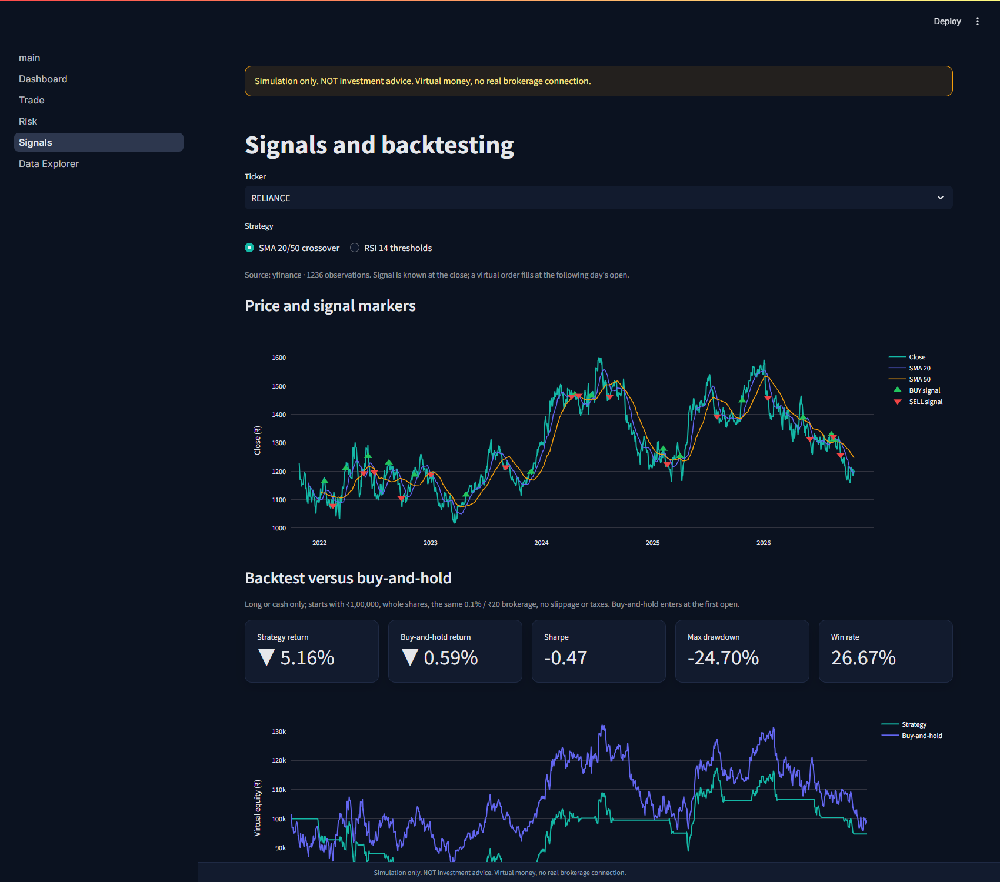
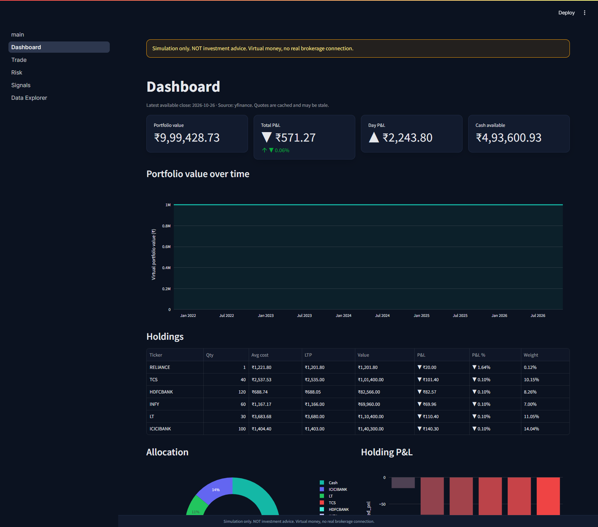
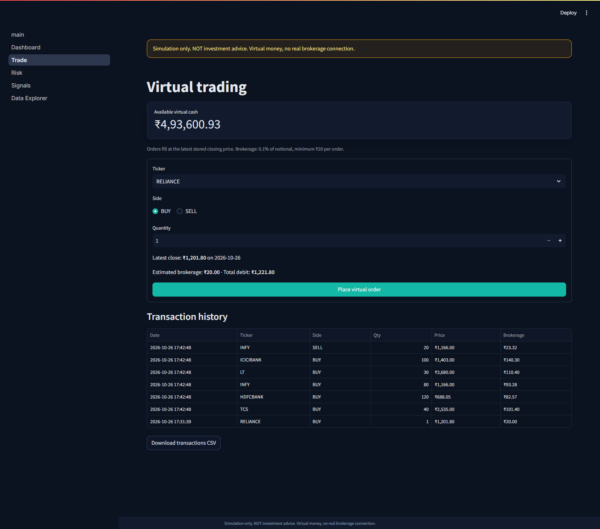
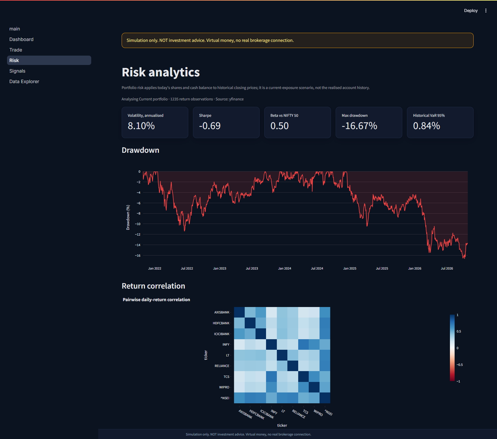
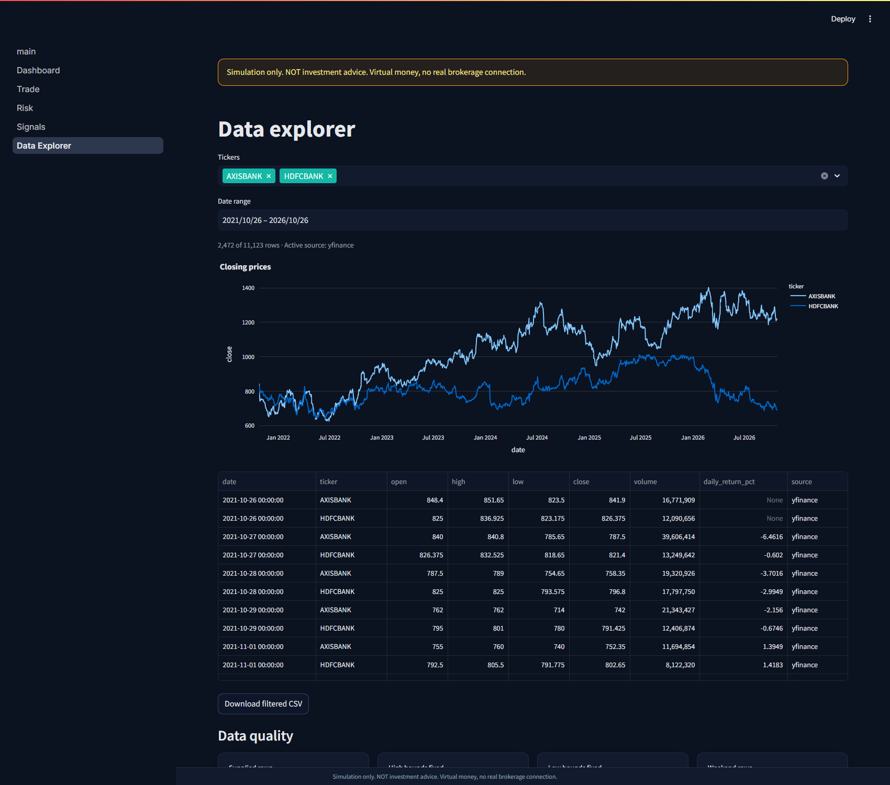
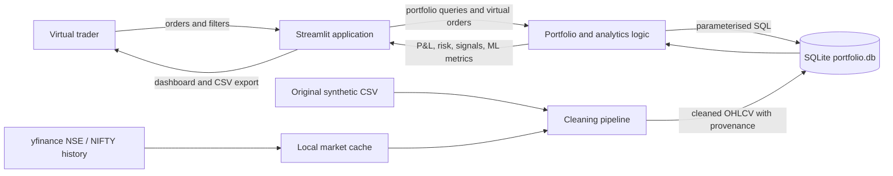

# Portfolio Lab

**A virtual NSE trading desk: paper-trade in ₹, then see the risk, signals and honest ML evaluation behind every position.**

[](https://www.python.org/)
[](https://streamlit.io/)
[](https://www.sqlite.org/)
[](https://scikit-learn.org/)
[](Dockerfile)
[](LICENSE)
[](#testing)

**Simulation only. NOT investment advice. Virtual money, no real brokerage connection.**

<p align="center">
  
</p>

[Live Demo](YOUR_STREAMLIT_URL)

## Contents

- [Screenshots](#screenshots)
- [Features](#features)
- [Tech Stack](#tech-stack)
- [Architecture](#architecture)
- [Project Structure](#project-structure)
- [Quick Start](#quick-start)
- [Configuration](#configuration)
- [Data](#data)
- [Methodology](#methodology)
- [Results](#results)
- [Testing](#testing)
- [Deployment](#deployment)
- [Roadmap](#roadmap)
- [Ethics and AI Disclosure](#ethics-and-ai-disclosure)
- [Author](#author)
- [License](#license)

## Screenshots

Demo portfolio with a handful of virtual trades; prices are a yfinance snapshot ending 2026-10-26.

| Page | Preview | What it shows |
| --- | --- | --- |
| Dashboard | <a href="docs/screenshots/01-dashboard.png"></a> | Portfolio value, total and day P&L, cash, holdings with fee-inclusive average cost, allocation |
| Trade | <a href="docs/screenshots/02-trade.png"></a> | Order ticket with brokerage preview, transaction history, CSV export |
| Risk | <a href="docs/screenshots/03-risk.png"></a> | Volatility, Sharpe, beta, max drawdown, 95% VaR, drawdown curve, correlation heatmap |
| Signals | <a href="docs/screenshots/04-signals.png"></a> | SMA/RSI markers, next-open backtest vs buy-and-hold, next-day direction model |
| Data Explorer | <a href="docs/screenshots/05-data-explorer.png"></a> | Filtered prices, CSV export, data-quality report |

## Features

- **Virtual trading:** buy and sell NSE stocks with ₹10,00,000 of virtual cash. Each order checks cash or shares, charges brokerage, and commits the trade and cash change in one SQLite transaction.
- **Portfolio accounting:** moving weighted-average cost with buy fees in the cost basis, realised and unrealised P&L, day P&L, allocation weights.
- **Risk analytics:** annualised volatility, Sharpe, beta vs NIFTY 50, maximum drawdown, historical 95% VaR, correlation heatmap.
- **Signals and backtest:** SMA 20/50 crossover and RSI 14 thresholds, executed at the next open and compared with buy-and-hold.
- **ML evaluation:** logistic-regression next-day direction model scored on a later, held-out period and shown beside a majority-class baseline.
- **Data quality:** cleaning report, provenance column on every price row, CSV export. Supplied synthetic data and real downloaded data are never blended.
- **Safeguards:** simulation warning on every page, annualised metrics withheld below 252 observations.

## Tech Stack

| Layer | Tools |
| --- | --- |
| Language | Python 3.11 |
| UI and charts | Streamlit 1.40.1, Plotly 6.3.1 |
| Data | pandas 2.2.3, NumPy 1.26.4, PyArrow 18.1.0, yfinance 0.2.66 |
| Storage | SQLite (standard-library `sqlite3`, parameterised SQL) |
| ML | scikit-learn 1.8.0 (`StandardScaler` + `LogisticRegression`) |
| Testing | pytest 8.2.0 |
| Packaging | Docker, Docker Compose |
| Report (optional) | ReportLab, Matplotlib, PyMuPDF via `requirements-report.txt` |

## Architecture



The pipeline loads **one** price source into SQLite: downloaded history when all eight stocks and NIFTY 50 have at least 252 rows, otherwise the supplied CSV. The system block diagram and key design decisions are in [docs/architecture.md](docs/architecture.md).

## Project Structure

```text
.
├── app/
│   ├── main.py                  # Home page and entry point
│   ├── theme.py                 # Shared theme and disclaimer banner
│   └── pages/                   # Dashboard, Trade, Risk, Signals, Data Explorer
├── src/
│   ├── config.py                # Paths, cash, risk-free rate, stock universe
│   ├── data_pipeline.py         # Cleaning, yfinance cache, SQLite load
│   ├── db.py                    # Schema and parameterised queries
│   ├── portfolio.py             # Orders, cost basis, valuation
│   ├── risk.py                  # Volatility, Sharpe, beta, drawdown, VaR
│   ├── signals.py               # SMA/RSI signals and backtest
│   └── ml_model.py              # Feature engineering and classifier
├── tests/                       # pytest suite (11 tests)
├── data/
│   ├── dataset.csv              # Supplied synthetic source (500 rows)
│   ├── cleaned_dataset.csv      # Repaired version of the supplied source
│   ├── quality_report.json      # Issues found and fixed
│   └── data_dictionary.csv
├── docs/
│   ├── architecture.md          # Mermaid diagrams and design decisions
│   ├── DEPLOYMENT.md            # Docker and Streamlit Community Cloud
│   ├── live_demo.md             # Two-minute demo script
│   ├── screenshots/             # README images
│   └── ...                      # Synopsis, data dictionary, report builder
├── notebooks/eda.ipynb          # Four EDA charts on the supplied data
├── output/pdf/                  # Generated academic report
├── Dockerfile, docker-compose.yml, docker-entrypoint.sh
├── requirements.txt, requirements-report.txt, .env.example
└── LICENSE
```

Generated at run time and git-ignored: `data/portfolio.db`, `data/market_cache.csv`.

## Quick Start

### Docker (any OS)

```bash
git clone https://github.com/URAYUSHJAIN/portfolio-lab.git
cd portfolio-lab
docker compose up --build
```

Open <http://localhost:8501>. On first start the container builds the database, then launches Streamlit. `./data` is mounted, so your virtual portfolio survives restarts.

### Windows PowerShell

Requires Python 3.11.

```powershell
git clone https://github.com/URAYUSHJAIN/portfolio-lab.git
cd portfolio-lab
py -3.11 -m venv .venv
# If activation is blocked: Set-ExecutionPolicy -Scope Process -ExecutionPolicy Bypass
.venv\Scripts\Activate.ps1
python -m pip install -r requirements.txt
python -m src.data_pipeline
python -m src.signals
streamlit run app/main.py
```

### macOS / Linux

Requires Python 3.11.

```bash
git clone https://github.com/URAYUSHJAIN/portfolio-lab.git
cd portfolio-lab
python3.11 -m venv .venv
source .venv/bin/activate
python -m pip install -r requirements.txt
python -m src.data_pipeline
python -m src.signals
streamlit run app/main.py
```

`python -m src.data_pipeline` downloads about five years of history from Yahoo Finance. Add `--no-download` to use an existing cache or the supplied synthetic CSV without any network request. Delete `data/portfolio.db` and rerun the pipeline to reset the virtual portfolio.

## Configuration

| Setting | Where | Default |
| --- | --- | --- |
| `HCL_DATA_DIR` | environment or `.env` | `<repo>/data` (`/app/data` in Docker) |
| `HCL_DB_PATH` | environment or `.env` | `<HCL_DATA_DIR>/portfolio.db` |
| Starting cash, risk-free rate, trading days, stock universe | [src/config.py](src/config.py) | ₹10,00,000, 6.5%, 252, 8 NSE stocks + NIFTY 50 |
| Brokerage | [src/portfolio.py](src/portfolio.py) | `max(₹20, 0.1% × notional)` per order |
| Download window | `download_market_history(years=5)` in [src/data_pipeline.py](src/data_pipeline.py) | 5 years |
| Theme and server | [.streamlit/config.toml](.streamlit/config.toml) | Dark theme, port 8501 |

`.env` is optional. To override paths, copy the template (`cp .env.example .env` on macOS/Linux, `Copy-Item .env.example .env` in PowerShell). Nothing in this project needs an API key.

## Data

### Sources

| Source | Content | Role |
| --- | --- | --- |
| `data/dataset.csv` (supplied) | **Synthetic**: 500 rows, 8 tickers, 63 calendar dates (2024-01-01 to 2024-03-03) | Fallback and cleaning demo |
| Yahoo Finance via `yfinance` | 8 NSE stocks (`.NS`) plus `^NSEI`: 11,123 rows, 2021-10-26 to 2026-10-26 | Active source for all analytics |

Downloaded history uses `auto_adjust=False`, so closes are split-adjusted but not dividend-adjusted. It is cached locally in `data/market_cache.csv`, which is **not** committed. Check Yahoo's terms before any commercial use.

### Issues found and fixed

| Issue | Count | Handling |
| --- | --- | --- |
| Supplied rows with `high` below `max(open, close)` | 126 of 500 | `high` raised to `max(high, open, close)` |
| Supplied rows with `low` above `min(open, close)` | 159 of 500 | `low` lowered to `min(low, open, close)` |
| Supplied rows dated on a weekend | 140 of 500 | Kept and flagged, because they are synthetic; never blended with real data |
| Supplied `daily_return_pct` | all rows | Recomputed from closes; first return per ticker left empty |
| Invalid rows / duplicate keys dropped | 0 / 0 | Validation covers nulls, non-positive prices, negative or fractional volume, unknown tickers |
| Downloaded rows dated on a weekend | 9 of 11,123 | Kept as published by the provider |
| Downloaded OHLC bound violations | 0 | None to fix |

The SQLite schema also enforces OHLC bounds with `CHECK` constraints, so a bad candle cannot be inserted.

### Row counts in `portfolio.db`

| Table | Rows |
| --- | --- |
| `prices` | 11,123 (1,236 per stock, 1,235 for NIFTY 50) |
| `signals` | 19,776 (8 stocks × 1,236 dates × 2 strategies) |
| `stocks` | 9 |
| `portfolio` | 1 |
| `transactions` | created by the user |

Full detail is in `data/quality_report.json` and `docs/data_dictionary.csv`.

## Methodology

Daily return: $r_t = P_t / P_{t-1} - 1$. Annualisation uses 252 trading days and the risk-free rate is $r_f = 6.5\%$. Annualised metrics need at least 252 return observations.

**Volatility and Sharpe**, with $s$ the sample standard deviation (ddof = 1) of daily returns:

$$\sigma_{ann} = s\sqrt{252} \qquad\qquad S = \frac{\bar r - r_f/252}{s}\sqrt{252}$$

**Beta** against NIFTY 50 on overlapping days:

$$\beta = \frac{\operatorname{Cov}(r_a, r_m)}{\operatorname{Var}(r_m)}$$

**Maximum drawdown** from compounded wealth $W_t = \prod_{i \le t}(1 + r_i)$:

$$DD_t = \frac{W_t}{\max_{u \le t} W_u} - 1 \qquad MDD = \min_t DD_t$$

**Historical 95% VaR** (one day, floored at zero): the negative 5th percentile of daily returns, $\mathrm{VaR}_{95} = -q_{0.05}(r)$. It is a sample quantile, not a loss limit.

**Correlation:** Pearson on overlapping daily returns (at least 30). Portfolio risk applies *today's* shares and cash to historical closes, so it is a current-exposure scenario, not realised account history.

**Technical signals**, computed from closes only:

```text
SMA signal : BUY  when SMA20 crosses above SMA50, SELL when it crosses below
             (no signal until 50 closes exist)
RSI(14)    : Wilder smoothing, alpha = 1/14
             RS = avg_gain / avg_loss,  RSI = 100 - 100 / (1 + RS)
             BUY when RSI < 30, SELL when RSI > 70
```

**Backtest:** a signal known at day $t$'s close fills at day $t+1$'s open. One long position or cash, whole shares, brokerage `max(₹20, 0.1% × notional)`, ₹1,00,000 start. Buy-and-hold enters at the first open. No slippage, taxes, exchange fees or liquidity limits.

**Next-day direction model**

```text
target     : 1 if Close(t+1) > Close(t) else 0
features   : return_1d, return_5d, range_pct, intraday_pct, volume_change,
             sma20_gap, sma50_gap, rsi14, volatility_5d   (all known at the close)
model      : StandardScaler -> LogisticRegression(class_weight="balanced",
             max_iter=1000, random_state=42)
split      : chronological - first 80% of samples train, last 20% test
leakage    : training rows whose label date falls on or after the test start are dropped
baseline   : always predict the majority class of the training labels
```

Per stock this gives 946 training and 237 test rows; the test period starts 2025-11-07. There is one split per stock, with no cross-validation or hyperparameter search.

## Results

Computed with the app's own functions on the yfinance snapshot ending 2026-10-26, and identical on the pinned Docker stack (Python 3.11, pandas 2.2.3) and on a local Python 3.12 run. Values change when the market cache is refreshed. The Risk and Signals pages show the same figures per ticker.

### Risk, 2021-10-26 to 2026-10-26 (1,235 daily returns per stock)

| Ticker | Volatility | Sharpe | Beta | Max drawdown | 95% VaR (1 day) |
| --- | --- | --- | --- | --- | --- |
| RELIANCE | 22.33% | -0.20 | 1.11 | -27.61% | 2.14% |
| TCS | 22.87% | -0.45 | 0.82 | -56.46% | 2.10% |
| INFY | 26.32% | -0.41 | 0.96 | -50.73% | 2.63% |
| HDFCBANK | 21.15% | -0.38 | 1.07 | -32.17% | 2.13% |
| ICICIBANK | 19.61% | 0.31 | 0.97 | -21.71% | 1.86% |
| WIPRO | 25.70% | -0.58 | 0.99 | -56.54% | 2.63% |
| LT | 24.44% | 0.46 | 1.19 | -28.88% | 2.20% |
| AXISBANK | 24.37% | 0.17 | 1.08 | -28.03% | 2.35% |
| NIFTY 50 | 13.89% | -0.08 | n/a | -16.47% | 1.41% |

The mean pairwise correlation among the eight stocks is 0.36 (range 0.18 to 0.73).

### Backtest vs buy-and-hold (₹1,00,000 start, total return)

| Ticker | Buy-and-hold | SMA 20/50 | RSI 14 | Round trips (SMA / RSI) |
| --- | --- | --- | --- | --- |
| RELIANCE | -0.59% | -5.16% | 19.50% | 15 / 6 |
| TCS | -26.96% | -23.94% | -3.62% | 15 / 5 |
| INFY | -31.65% | -21.71% | -20.31% | 13 / 4 |
| HDFCBANK | -16.67% | -36.50% | -5.13% | 18 / 5 |
| ICICIBANK | 68.82% | 0.88% | 94.16% | 15 / 7 |
| WIPRO | -43.56% | -32.37% | -34.14% | 16 / 5 |
| LT | 104.13% | 8.98% | 100.16% | 16 / 5 |
| AXISBANK | 43.38% | -5.15% | 29.61% | 15 / 5 |
| **Mean** | **12.11%** | **-14.37%** | **22.53%** | |

SMA 20/50 beat buy-and-hold on 3 of 8 stocks and RSI 14 on 6 of 8.

### Next-day direction model (237 held-out days per stock)

| Ticker | Accuracy | Majority baseline | Ticker | Accuracy | Majority baseline |
| --- | --- | --- | --- | --- | --- |
| RELIANCE | 55.27% | 47.68% | ICICIBANK | 50.63% | 49.37% |
| TCS | 52.74% | 53.59% | WIPRO | 47.68% | 51.90% |
| INFY | 45.15% | 55.27% | LT | 51.48% | 48.52% |
| HDFCBANK | 45.57% | 40.93% | AXISBANK | 51.90% | 50.63% |

Mean accuracy is **50.05%** against a **49.74%** baseline, and the model beats its baseline on 5 of 8 stocks.

### What these results do and do not show

- **No demonstrated predictive skill.** With 237 test days, one standard error on accuracy is about 3.2 points, so every gap above is within noise. Eight stocks were tested without any multiple-testing correction.
- **RSI results rest on few trades.** Each RSI backtest has 4 to 7 round trips, so a 100% win rate on five stocks is a small-sample outcome. Thresholds (30/70) and periods were fixed in advance, not tuned, but there is no out-of-sample period.
- **One market window.** The five years are a single regime. IT names (TCS, INFY, WIPRO) fell more than 50% from peak, which drives the negative Sharpe ratios against a 6.5% risk-free rate.
- **Returns exclude dividends.** The stored `close` is split-adjusted but not dividend-adjusted, so total returns are understated.
- **Hindsight in the stock list.** The eight stocks are large caps that still trade today (survivorship), and the NIFTY 50 benchmark is a price index.
- **Optimistic execution.** The backtest assumes fills at the open with no slippage, taxes or liquidity limits. Manual trades fill at the latest close.
- **Constant risk-free rate.** 6.5% is applied across the whole window.

## Testing

```bash
python -m pytest -q tests
python -m compileall -q src app
docker compose config --quiet
```

| File | Tests | Covers |
| --- | --- | --- |
| `tests/test_data_pipeline.py` | 2 | OHLC repair and return recalculation; schema rejects bad candles and negative cash |
| `tests/test_portfolio_risk.py` | 4 | Weighted-average cost and P&L; order guards; default fill at latest close; beta, drawdown and the 252-observation limit |
| `tests/test_signals_ml.py` | 4 | Backtest fills only at the next open; no SMA signal before 50 closes; minimum history for the model; chronological holdout with past-only features |
| `tests/test_runtime_dependencies.py` | 1 | PyArrow converts a pandas DataFrame |

Last run on 2026-10-26: **11 passed** locally (Python 3.12) and inside the Docker image (Python 3.11.17 with the pinned dependencies). The container built its database from scratch and reported `healthy`, and all six views (home plus five pages) rendered in headless Chrome. The tests badge is static; there is no CI workflow yet (see [Roadmap](#roadmap)).

## Deployment

- **Docker:** `docker compose up --build`, covered in [Quick Start](#quick-start).
- **Streamlit Community Cloud:** needs a seeded database committed first, because the cloud does not run the Docker entrypoint. Steps, limits and troubleshooting are in [docs/DEPLOYMENT.md](docs/DEPLOYMENT.md). A public demo shares one portfolio across all visitors and resets on redeploy.

## Roadmap

- [ ] GitHub Actions workflow running `pytest` and `compileall`, so the tests badge is backed by CI.
- [ ] Create the database on first run so Community Cloud works without a committed `portfolio.db`.
- [ ] Per-session portfolios instead of one shared demo portfolio.
- [ ] Walk-forward evaluation with several splits and a significance test for the classifier.
- [ ] Dividend-adjusted returns, plus slippage and statutory charges in the backtest.
- [ ] Scheduled price refresh.

## Ethics and AI Disclosure

- **Educational simulation.** No real brokerage connection, no real orders, no real money. Backtests and classifier scores describe the past and are not forecasts or recommendations.
- **Privacy.** No authentication and no personal data are collected or stored.
- **Data.** The supplied dataset is synthetic. Market data comes from Yahoo Finance through `yfinance` for educational use and is not redistributed in this repository.
- **AI assistance.** AI coding assistants, including Claude Code, were used in developing the code, tests, report and documentation, including this README. Every figure in the README was recomputed from the code and data on 2026-10-26.
- **Declaration.** [docs/ethical_compliance_declaration.md](docs/ethical_compliance_declaration.md) is intentionally unsigned. The official programme declaration must be reviewed and signed by the learner personally.

## Author

**Ayush Jain**, B.Tech CSE, ABES Engineering College. HCLTech Career Shaper 2025-26, Project 25.

- GitHub: [github.com/URAYUSHJAIN](https://github.com/URAYUSHJAIN)
- Portfolio: [urayushjain.tech](https://urayushjain.tech)

## License

Released under the [MIT License](LICENSE). Copyright (c) 2026 Ayush Jain.
