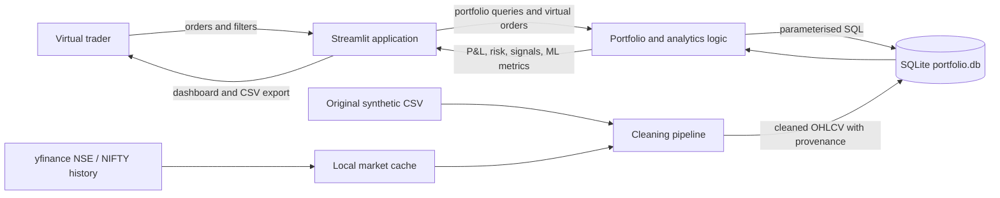

# Architecture

## Data flow diagram, level 0



## System block diagram

```mermaid
flowchart TB
    subgraph Container[Python 3.11 container]
      Web[Streamlit multipage UI + shared theme]
      Services[Portfolio | Risk | Signals | ML]
      Pipeline[Data cleaning and yfinance cache]
      Store[(SQLite: stocks, prices, portfolio, transactions, signals)]
      Web --> Services
      Services --> Store
      Pipeline --> Store
    end
    Data[Mounted ./data volume] --> Pipeline
    Store <--> Data
    Browser[Browser on port 8501] <--> Web
```

## Key decisions

- The supplied CSV is synthetic and contains weekends. Its cleaned rows are kept in `cleaned_dataset.csv` and are not blended into real downloaded history.
- If all eight stocks and NIFTY 50 have at least 252 observations, downloaded data becomes the active price source; otherwise the app uses the supplied data and withholds annualised risk and ML metrics.
- Cash and transaction rows are durable in SQLite. Each virtual order validates funds or shares and commits the order and cash change in one SQLite transaction.
- Backtests use signals known at a close and execute at the following open. The ML split is chronological, with a one-row gap so no training label uses a test-period close.
- No real brokerage connection, authentication, or personal information is included.
